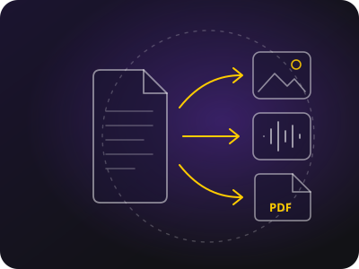

# Universal Converter

<p align="center"></p>

🇬🇧 **English** · 🇮🇹 [Italiano](README.it.md)

**A self-hosted file converter, in the spirit of iLovePDF.** Documents, spreadsheets, presentations, images, audio, video, subtitles, ebooks, data, fonts and archives: about **200 formats** and more than **3,000 combinations**, all on your own server. Files never leave your network and are deleted automatically after a few hours.


## Features

- **Web page** with ready-made tools ("Word to PDF", "HEIC to JPG", "JSON to Excel"…), drag and drop, and batch conversion of several files at once.
- **Chained conversions**: when no single program can do a conversion, the server finds the shortest path. Markdown → PDF becomes Pandoc + LibreOffice, JSON → Excel becomes JSON → CSV → XLSX.
- **Fast where possible**: videos with compatible codecs are copied without re-encoding, in a few seconds.
- **JSON API** for scripts and other applications.
- **Nextcloud app** (optional): right-click a file → **Converti in ▸ format** ("Convert to"), and the result appears next to the original.
- **Automatic PDFs** (optional) next to Xournal++ notes and Office documents in Nextcloud.
- **Robust**: a queue with a limit on concurrent conversions, timeouts, a size limit on generated files, automatic cleanup.

| Category | Some formats |
|---|---|
| Documents | PDF, DOCX, ODT, RTF, Markdown, HTML, LaTeX, AsciiDoc, Typst, Pages, Xournal++ |
| Spreadsheets and presentations | XLSX, ODS, CSV, Numbers, PPTX, ODP, Keynote |
| Images and drawings | JPG, PNG, WEBP, HEIC, AVIF, SVG, EPS, PSD, camera RAW, CorelDRAW, Visio |
| Audio and video | MP3, FLAC, WAV, OPUS, MP4, MKV, MOV, WEBM, GIF |
| Other | subtitles (SRT, VTT, ASS), ebooks (EPUB, MOBI, AZW3, CBR), data (JSON, YAML, TOML), fonts (TTF, OTF, WOFF2), archives (ZIP, 7Z, RAR, TAR.ZST, ISO) |

> The user interface is in Italian. The API, the formats and this documentation are language-independent.

## Quick start

You need Docker with Docker Compose.

```bash
git clone https://github.com/EmaLau/universal-converter.git
cd universal-converter
docker compose up -d --build
```

Open <http://localhost:8080>. The built-in documentation (in Italian) is at <http://localhost:8080/docs>; the English version is [here](server/docs/documentation.md).

The first build downloads LibreOffice, FFmpeg, Calibre and the other programs (about 500 MB), so it takes a few minutes. Later builds are almost instant.

To check that every conversion works:

```bash
docker compose exec converter python3 /app/selftest.py
```

> **Security note.** The service has no login and by default listens only on `127.0.0.1`. Open it to the network only if the network is trusted (home, VPN), or put it behind a reverse proxy with authentication. Do not expose it directly to the Internet.

## Configuration

Copy `.env.example` to `.env` and change what you need. The main options:

| Variable | Default | Description |
|---|---|---|
| `CONVERTER_BIND` / `CONVERTER_PORT` | `127.0.0.1` / `8080` | Where to publish the service (`0.0.0.0` for the whole network) |
| `MAX_PARALLEL` | `2` | Concurrent conversions |
| `RETAIN_HOURS` | `6` | Hours after which results are deleted |
| `MAX_UPLOAD_GB` | `20` | Maximum size of an uploaded file |
| `MAX_OUTPUT_GB` | `50` | Maximum size of each file created during a conversion |
| `DISABLED_CONVERSIONS` | empty | Conversions to hide, e.g. `heic>avif,pdf>epub` |

The full list is in [`.env.example`](.env.example) and in the [documentation](server/docs/documentation.md#configuration).

## API at a glance

```bash
# upload a file and choose the target format
id=$(curl -s -F file=@report.docx -F target=pdf http://localhost:8080/api/jobs | jq -r .id)

# check the status: queued, running, done or error
curl -s http://localhost:8080/api/jobs/$id

# download the result
curl -OJ http://localhost:8080/api/jobs/$id/download
```

Other endpoints: `GET /api/formats` (supported formats), `GET /api/plan/{from}/{to}` (planned steps), `DELETE /api/jobs/{id}` (delete now), `GET /healthz`. Details are in the [API documentation](server/docs/documentation.md#api).

## Nextcloud

```bash
cp -r nextcloud-app /path/to/nextcloud/custom_apps/convertitore
occ app:enable convertitore
occ config:app:set convertitore converter_url --value=http://converter-address:8080
```

The address must be reachable from the Nextcloud server. Installation and behaviour are explained in the [documentation](server/docs/documentation.md#nextcloud-integration), together with the [automatic PDFs](server/docs/documentation.md#automatic-pdfs-for-nextcloud).

## Project layout

```
server/            web service (FastAPI) and Dockerfile
  converter/       code: API, job queue, conversion graph, converters
  docs/            full documentation (the Italian file becomes the /docs page)
  tests/           pytest tests
  selftest.py      real test of every conversion
nextcloud-app/     Nextcloud app "Converti in" (Convert to)
pdf-watcher/       automatic PDFs for Nextcloud
```

## Development

```bash
cd server
python3 -m venv .venv && .venv/bin/pip install -e ".[test]"
.venv/bin/python -m pytest
```

Adding a format takes one function in `tools.py` and one line in `graph.py`: menus, chained paths and the Nextcloud app update themselves. The step-by-step guide is in the [Development](server/docs/documentation.md#development) section.

## Documentation

The [full documentation](server/docs/documentation.md) covers installation, configuration, usage, the API, internals, Nextcloud, security, maintenance, known issues and FAQ. An Italian version ([`documentazione.md`](server/docs/documentazione.md)) is also served by every instance at `/docs`.

## License

[GNU Affero General Public License v3.0](LICENSE). You are free to use, modify and redistribute the project. If you modify it and offer it as a network service, you must also make the source code of your changes available.
